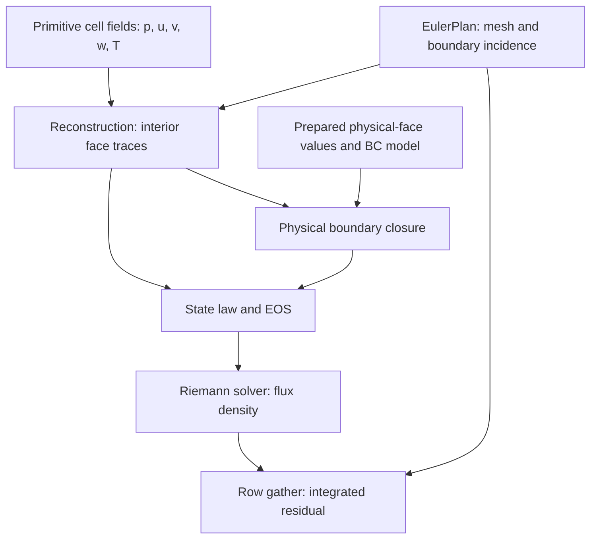

# Euler spatial operator

The module in `krona/transport/euler` assembles the inviscid, compressible
finite-volume residual on a static distributed mesh. It connects existing
primitive fields, reconstruction policies, an equation of state, a Riemann
solver and the physical boundary manager.

The application owns the solution and residual fields. It also prepares
primitive variables, physical-face values, gradients, limiter factors and MPI
ghost data. The Euler operator consumes these inputs and adds flux contributions
to the residual. It performs no halo exchange or time update.

## 1. Equation, sign and units

The conservative variables are densities:

\[
U=(\rho,\rho u,\rho v,\rho w,\rho E)^T,
\qquad E=e+\tfrac12|\mathbf u|^2.
\]

For an outward unit normal, the physical Euler flux density is

\[
F_n(U)=
\begin{pmatrix}
\rho u_n\\
\rho\mathbf u\,u_n+p\mathbf n\\
(\rho E+p)u_n
\end{pmatrix},
\qquad u_n=\mathbf u\cdot\mathbf n.
\]

The numerical flux replaces this expression at a discontinuous face. For each
owned cell, the operator **adds**

\[
r_i\mathrel{+}=-\sum_{f\in\partial i}A_f\widehat F(U_L,U_R,\mathbf n_{i,f}).
\]

Consequently:

- The result is an integrated negative outward flux sum, not a volume-normalized derivative.
- Face area is included exactly once by the assembly kernels. Riemann solvers return flux densities.
- Existing residual values are preserved; clearing belongs to the caller.
- For conservative densities on a static mesh, a subsequent explicit Euler update would be `U_new = U_old + dt*r/volume`. That update is outside this module.

The operator reconstructs **primitive** variables in the fixed order
`p, u, v, w, T`; the output order is `rho, rho*u, rho*v, rho*w, rho*E`.
Conservative density, momentum and energy fields are not operator inputs.
The application must ensure that the primitive fields correspond to its current
conservative state and use the same EOS and energy convention.

## 2. How the objects fit together



An inner face supplies two reconstructed cell traces. A physical boundary
supplies one reconstructed interior trace and a locally constructed exterior
trace. Both routes prepare thermodynamic states and call the same Riemann solver.

| Object | Responsibility | Storage and ownership |
|---|---|---|
| `EulerPlan<Exec, Real>` | Validates the partition and builds reusable boundary row maps. | Borrows mesh/connectivity; owns small host metadata and managed boundary-index arrays. |
| `Reconstruction<Scheme, Data, Stencil, BoundaryScheme>` | Reconstructs the five primitive components at a face. | Copies policy values and borrowed descriptors; allocates no field arrays. |
| `Thermodynamics<EOS, Domain>` | Converts primitive traces into Riemann states, with an optional EOS-domain guard. | Stores EOS and guard by value. |
| `PreparedExterior` / `EvaluatedExterior` | Chooses how to construct the exterior boundary trace. | Small policies; no boundary-state storage. |
| `EulerOperator<StateLaw, Solver, Exec, Real, Accumulator>` | Launches additive residual assembly. | Stores a plan copy, state law and Riemann solver; owns no solution or residual arrays. |
| `AssemblyStatus<Exec>` | Records errors and fallback counts for an asynchronous batch. | Owns a small device diagnostic buffer and an independent host buffer. |

`detail::Physics` is the internal device-callable combination of reconstruction,
state law, solver and diagnostic flags. It prepares base/reconstructed states,
applies reconstruction fallback, evaluates boundary closures and checks Riemann
results. Application code normally uses `EulerOperator`, not this internal type.

## 3. Mesh requirements and `EulerPlan`

Construction takes the host partition, its compute view, owned-cell face
incidence, communicator and execution instance:

```cpp
eu::EulerPlan<Exec, Real> plan(
    host_mesh, mesh_view, connectivity_view, comm, exec);
```

The compute mesh must provide:

- `MeshData::FaceCells`, `CellGeometry` and `FaceGeometry`;
- `AuxConnType::CellFaces` for owned cells;
- grouped faces with the usual internal, MPI-interface and physical-boundary intervals.

Normals are unit vectors directed from owner to neighbour; physical-boundary
normals point outward. Areas are separate geometry arrays. No diffusion
distances, interpolation weights or non-orthogonality vectors are required by
the Euler assembly itself. A chosen reconstruction can impose additional stencil
geometry requirements.

The host and compute descriptors must represent the same partition, face ranges
and physical boundary ownership. Construction checks mesh/communicator rank and
size, validates local geometry and incidence, constructs the boundary maps and
checks their ownership against the compute mesh.

**Construction is local and blocking.** Validation reductions return host
results, and uploading the new maps completes before temporary host buffers are
released. This is setup work; residual contribution methods do not repeat these
mesh-validation kernels.

### Row gather and boundary maps

For inner faces, one thread owns one residual row and loops over its cell faces.
An owned-owned face is evaluated twice. Both evaluations use the canonical
owner/neighbour state order and normal; the owner subtracts the integrated flux
and the neighbour adds it. Across an MPI interface, each rank computes its owned
cell contribution from locally available real/ghost data.

For boundaries, the manager supplies a typed condition for each patch. The plan
groups that patch's faces by owned cell, allowing one thread per `(patch, cell)`
group. Different patches may touch the same cell, so their kernels are ordered
on the same execution instance.

This implementation has no five-component face-flux array and uses no atomics
for residual updates. Diagnostic flags/counters do use atomics. For `B` physical
boundary faces and `G` patch/cell groups, the boundary device maps contain `B+G`
local indices and `G+1` offsets. They hold topology, not solution values.

Plan copies share these managed device maps; small host metadata is copied
normally. Mesh and connectivity owners must remain alive, and their contents
must remain compatible with the plan, until all users complete. The plan borrows
the communicator. Repartitioning or changing topology requires a new plan;
moving geometry is outside the current contract.

## 4. Field bindings and extents

The examples below use these aliases:

```cpp
namespace eu = krona::transport::euler;
namespace rec = krona::numerics::reconstruction;
namespace ri = krona::numerics::riemann;
namespace ph = krona::boundary::physical;

using Exec = krona::execution::ExecutionSpace;
using Space = typename Exec::memory_space;
using Real = krona::ComputeReal;
using Stored = krona::StorageReal;
using Accum = krona::AccumulationReal;
```

| Data | Component order | Required extent |
|---|---|---|
| Primitive values for inner contributions | `p, u, v, w, T` | At least `n_cells`, including MPI ghosts; any wider stencil can require more samples. |
| Primitive values for boundary/full contributions | Same | At least `n_cells + n_faces - n_inner_faces`. |
| Residual | `rho, rho*u, rho*v, rho*w, rho*E` | At least `n_own`; only selected owned entries are written. |
| Gradient/factor/Hessian/moment providers | Reconstruction-dependent | The Euler adapter checks `size() >= n_cells` when that provider exposes `size()` and its requirement bit is present. All actual stencil accesses must also be valid. |

The extended index for a physical face is

```cpp
extended_index = n_cells + face - n_inner_faces;
```

`face` is the rank-local face index. The extended slot holds the physical value
at that face. MPI ghost cells remain real neighbouring cells; physical boundary
slots do not represent ghost cells.

For separate scalar pressure/temperature fields and a three-component velocity:

```cpp
const auto primitive = eu::primitive_fields(
    pressure.view(), velocity.view(), temperature.view());

const auto residual = eu::conservative_fields(
    residual_density.view(), residual_momentum.view(), residual_energy.view());
```

For separately stored rank-one Kokkos views, use
`eu::primitive_components(p, u, v, w, T)`. A five-component residual can likewise
be bound with `rec::pack(r_rho, r_rhou, r_rhov, r_rhow, r_rhoE)`.

These adapters retain pointers, strides and the minimum component extent. They
do not allocate, copy, transpose or own the underlying arrays. Within one pack,
the component scalar types and memory spaces must agree. Primitive and residual
packs may use different floating-point types. SoA and strided AoS bindings are
supported; no contiguous-component assumption is made.

Policies and provider descriptors copied into kernels must be device-copyable;
their evaluation methods must be callable on the selected execution backend.

All backing storage must outlive queued work. Output components must not overlap
one another or any input, gradient, limiter or other stencil data. Host checks
detect identical pointers for standard packs, but do not prove absence of
partial/strided overlap. That broader non-aliasing contract belongs to the caller.
Exact input/output alias checks cover primitive packs and the standard gradient
and factor packs; they do not inspect arbitrary Hessian/moment/custom providers.

## 5. Minimal complete assembly example

This function assumes MPI and Kokkos are active and the supplied mesh/connectivity
views are ready. It allocates separate fields, prepares a uniform gas at rest,
sets slip walls on every patch and assembles the residual. On a consistent closed
mesh, the residual should be close to zero. It illustrates wiring rather than a
time-marching application.

```cpp
#include <krona/transport/euler/operator.hpp>
#include <krona/boundary/physical/manager.hpp>
#include <krona/fields/field_storage.hpp>

void assemble_uniform_example(
    const krona::mesh::MeshPart& host_mesh,
    krona::mesh::compute::MeshView<Space> mesh,
    krona::mesh::compute::AuxConnectivityView<Space> connectivity,
    krona::mpi::CommView comm, const Exec& exec)
{
    namespace fields = krona::fields;
    const auto n_owned = static_cast<std::size_t>(mesh.sizes.n_own);
    const auto n_extended = static_cast<std::size_t>(mesh.sizes.n_cells)
        + static_cast<std::size_t>(mesh.sizes.n_faces - mesh.sizes.n_inner_faces);

    fields::FieldStorage<Stored, 1, Exec> pressure(
        "p", n_extended, fields::FieldLocation::Custom, exec);
    fields::FieldStorage<Stored, 3, Exec> velocity(
        "u", n_extended, fields::FieldLocation::Custom, exec);
    fields::FieldStorage<Stored, 1, Exec> temperature(
        "T", n_extended, fields::FieldLocation::Custom, exec);
    fields::FieldStorage<Accum, 1, Exec> residual_density(
        "r_rho", n_owned, fields::FieldLocation::Custom, exec);
    fields::FieldStorage<Accum, 3, Exec> residual_momentum(
        "r_momentum", n_owned, fields::FieldLocation::Custom, exec);
    fields::FieldStorage<Accum, 1, Exec> residual_energy(
        "r_energy", n_owned, fields::FieldLocation::Custom, exec);

    eu::EulerPlan<Exec, Real> plan(host_mesh, mesh, connectivity, comm, exec);
    krona::thermodynamics::IdealGas<Real> eos;
    using Model = ph::Compressible<decltype(eos)>;
    ph::Manager<Model, Exec, Real> boundary(
        host_mesh, mesh, Model{eos, {}}, exec);
    for (const auto& patch : boundary.catalog().patches())
        boundary.set(patch.range.patch_id, ph::SlipWall<Real>{});
    if (boundary.catalog().needs_unlabelled())
        boundary.set_unlabelled(ph::SlipWall<Real>{});

    // Uniform values also initialize real MPI ghost entries for this example.
    pressure.fill(exec, Stored{100000});
    velocity.fill(exec, Stored{0});
    temperature.fill(exec, Stored{300});
    boundary.apply_async(ph::primitive_views(
        pressure.view(), velocity.view(), temperature.view()));

    const auto primitive = eu::primitive_fields(
        pressure.view(), velocity.view(), temperature.view());
    const auto residual = eu::conservative_fields(
        residual_density.view(), residual_momentum.view(), residual_energy.view());
    const rec::MeshStencil<Space, Real> stencil(mesh, connectivity);
    const eu::Reconstruction reconstruction{
        rec::FirstOrder{}, rec::data(primitive), stencil};
    const eu::EulerOperator op{plan, eu::Thermodynamics{eos}}; // default HLLC
    eu::AssemblyStatus<Exec> status(exec);

    residual_density.fill(exec, Accum{0});
    residual_momentum.fill(exec, Accum{0});
    residual_energy.fill(exec, Accum{0});
    status.begin_async();
    op.add_residual_async(reconstruction, residual, boundary, status);
    const auto report = status.check(comm);
    (void)report;
    // Owned residual fields are complete here; consume or inspect them as needed.
}
```

In an actual application, reuse the plan, boundary manager, fields, operator and
status across evaluations. Replace the uniform initialization with the current
primitive preparation and halo workflow. The physical boundary manager and state
law must use the same material parameters; this consistency is not inferred from
their types or checked by comparing EOS objects.

## 6. Reconstruction and batching

`eu::Reconstruction` adapts the existing reconstruction module to five-component
Euler primitives. It returns both inner traces through `interior<Real>(face)`
and only the interior boundary trace through `boundary<Real>(face)`. These are
device operations performed inside residual kernels, not separate launches or
temporary face arrays.

| Scheme | Data beyond primitive values |
|---|---|
| `rec::FirstOrder` | None; the operator directly uses the base cell state. |
| `rec::SecondOrderUpwind` | Cell gradients; unlimited linear reconstruction. |
| `rec::LimitedLinear` | Gradients and externally prepared factors for effective limiting. |
| `rec::Tvd<>` | Gradients and other-side primitive samples; ratio limiting is evaluated locally. |
| `rec::MusclKappa<>` | Gradients and other-side values; retains its own skew policy and parameters. |
| `rec::Quadratic` / `LimitedQuadratic` | Gradients, Hessians and cell moments; the limited variant also consumes factors. |
| `rec::Quick` | Explicit three-point stencil sides, including an explicit boundary-side stencil. |

The schemes keep their original reconstruction-module contracts. In particular,
a multidimensional TVD/skew formulation is not automatically a global boundedness
or positivity guarantee. The Euler adapter does not manufacture QUICK samples,
Hessians, moments or limiter factors.

### Gradients and limited linear reconstruction

`rec::gradient_pack` adapts a 15-component field with `3*c + axis` ordering:

| Primitive component | Gradient components |
|---|---|
| `p` | `0, 1, 2` |
| `u` | `3, 4, 5` |
| `v` | `6, 7, 8` |
| `w` | `9, 10, 11` |
| `T` | `12, 13, 14` |

Given ready primitive gradients and limiter fields:

```cpp
const auto gradients = rec::gradient_pack(primitive_gradients.view());
const auto factors = rec::field_pack(limiter_factors.view());
const eu::Reconstruction reconstruction{
    rec::LimitedLinear{}, rec::data(primitive, gradients, factors), stencil};
```

Factors have either one component shared by the five primitives or five
component-specific values, and must satisfy the reconstruction contract
`0 <= factor <= 1`. Omitting the factor provider selects the reconstruction
module's unit factors: choosing `LimitedLinear` alone does not compute a limiter.

For example, the existing limiter module can prepare one shared factor per
owned cell from ready values and gradients:

```cpp
rec::compute_limiters_async<Real>(
    exec, stencil, rec::data(primitive, gradients), factors,
    rec::BarthJespersen{}, rec::SecondOrderUpwind{}, rec::SharedMinimum{});
```

This call requires a one-component factor field for the shown binding. A
five-component output is also supported by `SharedMinimum`. Use the same
underlying unlimited scheme and evaluation points for factor preparation and
consumption. With `MeshStencil`, limiter bounds read neighbouring real cells
and extended physical-face samples, so those values must already be current.
Factor preparation writes owned entries only; exchange factors and any needed
gradients externally before reconstructing an MPI ghost side.

### Interior and boundary schemes

The three-argument form copies the **configured scheme instance**, including its
parameters, for boundary reconstruction. A fourth argument chooses a different
boundary scheme explicitly:

```cpp
const eu::Reconstruction reconstruction{
    rec::LimitedLinear{}, rec::data(primitive, gradients, factors), stencil,
    rec::FirstOrder{}};
```

For custom stencils, the interior adapter prefers `stencil.face<Scheme>(face)`
when available, otherwise `stencil.face(face)`. Boundary reconstruction uses
`stencil.boundary_side(face)`. Sample indices and geometry must correspond to
the plan and be valid for the selected schemes. Standard descriptor checks do
not inspect every custom stencil sample.

## 7. State law, EOS and Riemann solver

These are independent policy types selected at compile time. A state law takes
`ph::Primitive<Real, true>` and returns `ri::State<Real>`:

\[
(p,\mathbf u,T)\longmapsto(\rho,\mathbf u,p,e,a).
\]

The default adapter is `eu::Thermodynamics{eos}`. For the current ideal gas,
the existing Riemann adapter uses its fast path without evaluating unused entropy
or logarithms. A generic EOS supplies `validate()` and `from_pT(p, T)` with the
density, internal-energy and sound-speed members expected by the existing
Riemann EOS adapter. A custom state-law type can replace this preparation; its
host `validate()` is called by the operator constructor when available.

The current state-law call receives the primitive state, not a cell/face context.
There is no automatic material-ID or composition-field dispatch. The boundary
model must independently support the chosen EOS and boundary conditions.

### Domain guards and reconstruction fallback

Finite primitive values and positive `p,T` are checked before EOS preparation.
`Thermodynamics` then calls its additional `domain(eos, primitive)` predicate.
The default `PositivePT` predicate returns `true`: the preceding check already
enforces positive finite `p,T`.

For a model restricted to a temperature interval, an additional guard could be:

```cpp
struct TemperatureDomain {
    Real minimum = Real{200}, maximum = Real{3000};
    template<class EOS, class Primitive>
    KOKKOS_INLINE_FUNCTION bool operator()(const EOS&, const Primitive& q) const
    { return q.temperature >= minimum && q.temperature <= maximum; }
};

// Use instead of the default state law when this is the actual EOS domain.
const auto state_law = eu::Thermodynamics{eos, TemperatureDomain{}};
```

The application must cover the EOS's actual domain. A generic EOS retains its
own error policy: an abort inside EOS evaluation cannot be caught afterward and
turned into a fallback. This guard applies to Euler state preparation; it does
not add protection to separate EOS calls made during external BC preparation.

Prepared states must have finite positive density, pressure and sound speed,
finite internal energy, and finite conservative densities. Internal energy is
not universally required to be positive because its reference belongs to the EOS.

If a reconstructed side is inadmissible, the operator replaces **all five
components of that side** with its valid base-cell state and counts the event.
It does not clamp pressure/temperature independently. Invalid base-cell states
and invalid exterior boundary states are errors, not reconstruction fallbacks.

### Selecting the flux

```cpp
#include <krona/numerics/riemann/roe.hpp>

const eu::EulerOperator hllc{plan, eu::Thermodynamics{eos}};
const eu::EulerOperator rusanov{
    plan, eu::Thermodynamics{eos}, ri::Rusanov{}};
const eu::EulerOperator hll{
    plan, eu::Thermodynamics{eos}, ri::Hll<>{}};
const eu::EulerOperator roe{
    plan, eu::Thermodynamics{eos}, ri::Roe{eos.gamma}};
```

| Solver | Relevant contract |
|---|---|
| `ri::Hllc<>` | Default three-wave solver with Davis wave-speed estimates; its configured HLL fallback is reported. |
| `ri::Rusanov` | Uses prepared acoustic states and endpoint signal speeds. |
| `ri::Hll<>` | Two-wave flux with its chosen wave-speed policy. |
| `ri::Roe` | Current implementation is for one calorically perfect gas; its gamma must match the EOS. |

Custom solvers implement device-callable
`solver(ri::State<Real>, ri::State<Real>, ri::Vector<Real> unit_normal)` and
return the existing `ri::Result<Real>` convention. Return a **flux density**, not
an area-integrated flux. Respect the Riemann module's EOS/solver assumptions;
accepting a generic state type does not establish validity for every EOS.

The operator checks the returned status and counts successful reported Riemann
fallbacks. It does not introduce an additional flux fallback. The result's
`max_signal_speed` is not accumulated or exposed by the Euler operator as a CFL
estimate.

## 8. Physical boundaries: face values and exterior traces

The boundary manager must use the same compute geometry arrays and matching
patch ranges as the plan. Its model must declare `compressible = true` and
`thermal = true`. Every labelled patch must have a condition; unlabelled physical
faces require the manager's explicit unlabelled condition.

Before boundary/full assembly, prepare the extended physical-face values using
the existing manager or an equivalent application workflow:

```cpp
boundary.apply_async(ph::primitive_views(
    pressure.view(), velocity.view(), temperature.view()));
```

Supply the boundary module's thermal law/correction arguments when its configured
conditions need them. For example, preparing a physical heat-flux wall still
requires a flux-to-gradient law. The Euler operator does not perform that
preparation for the caller.

The operator obtains typed conditions through `for_each_patch`, reconstructs the
interior trace and invokes a closure. The closure returns a temporary exterior
primitive state, which is converted through the state law before the Riemann
call. No exterior state is stored in the extended arrays.

### Default: `PreparedExterior`

| Condition | Exterior state supplied to the Riemann solver |
|---|---|
| `SupersonicInlet`, `TotalConditionsInlet`, `VelocityInlet`, `PressureOutlet` | Already prepared physical-face primitive value. |
| `SlipWall`, `AdiabaticWall`, `IsothermalWall`, `HeatFluxWall` | Mechanical mirror of the reconstructed interior trace, relative to wall velocity. |
| `Symmetry` | Existing physical symmetry evaluation from the reconstructed inside. |
| `SupersonicOutlet` | Existing physical evaluation, including its incoming-characteristic check. |
| Custom condition | Existing `physical::evaluate(...).exterior`, unless a replacement closure is supplied. |

For walls, the mechanical mirror is

\[
\mathbf u_{ext}=\mathbf u_{in}
-2[(\mathbf u_{in}-\mathbf u_w)\cdot\mathbf n]\mathbf n,
\qquad p_{ext}=p_{in},\quad T_{ext}=T_{in}.
\]

Tangential no-slip data and wall temperature/heat flux belong to the viscous and
thermal treatment. They are not inserted into the inviscid mirror. This is why
all built-in wall types reuse the mechanical `SlipWall` exterior calculation.
The physical-face values remain available for gradients and later viscous fluxes.

For prepared inlet/pressure conditions, a profile written into the physical-face
slots is consumed directly. Its accuracy is the accuracy of the external
preparation; reconstructing the interior trace does not automatically upgrade
the prepared exterior to the same order.

### Alternative: `EvaluatedExterior`

```cpp
op.add_residual_async(reconstruction, residual, boundary, status,
                      eu::EvaluatedExterior<>{}, time);
```

This policy re-evaluates existing physical boundary conditions from the current
reconstructed interior trace. Standard walls and symmetry keep the mechanical
handling above. Other conditions call
`physical::evaluate(condition, context, inside, model, law, correction).exterior`.
The policy can carry optional law/correction objects for conditions that use them.

This is useful when a characteristic boundary should respond to the reconstructed
interior state rather than an earlier owner-cell-based preparation. For those
conditions, manually edited prepared face profiles are not consumed by this
policy. Choose a closure consistent with how the boundary data are defined.

Both policies retain the full boundary-call storage contract: the current kernel
loads the prepared face primitive before invoking the closure. Keep those slots
allocated and current even when a particular closure branch ignores their values.

A replacement closure implements
`closure(context, condition, inside, prepared_face, local_model)` and returns
`ph::Primitive<Real, true>`. If the manager's model offers
`model.at(context, condition)`, the Euler kernel passes that local model;
otherwise it passes the manager's model directly. The separate state law must
remain thermodynamically consistent with it.

`time` is forwarded into the boundary context. It does not refresh previously
prepared profiles. With the default policy, time-dependent inlet/pressure face
values must be updated externally for the requested time/stage.

## 9. Operator API and accumulation

The constructor selects the plan, state law and optional Riemann solver. The
execution instance is taken from the plan; contribution methods do not accept a
different instance.

```cpp
op.add_inner_residual_async(reconstruction, residual, status,
                            face_range, cell_range);

op.add_boundary_residual_async(reconstruction, residual, boundary, status,
                               closure, time, cell_range);

op.add_residual_async(reconstruction, residual, boundary, status,
                      closure, time, cell_range);
```

Trailing arguments are optional. The full call adds all inner and physical
boundary contributions. Do not call the full version and then add its component
contributions again unless double accumulation is intended.

| Argument | Default and meaning |
|---|---|
| `face_range` | `FaceRange{0, -1}`: all inner faces; `end == -1` resolves to `n_inner_faces`. |
| `cell_range` | All owned cells; explicit ranges are half-open `[begin, end)`. |
| `closure` | `PreparedExterior{}`. |
| `time` | Zero; must be finite. |

Face ranges apply only to inner contributions and must lie within
`[0, n_inner_faces)`. Cell ranges restrict output rows; a boundary call still
uses the patch-group maps and skips groups outside the selected cells.
Even a restricted call retains the standard descriptor extent checks.

To pass time, supply the closure argument explicitly:

```cpp
op.add_residual_async(reconstruction, residual, boundary, status,
                      eu::PreparedExterior{}, time);
```

The operator supports additive assembly into caller-owned residuals. Multiple
operators or contributions may share those outputs when their writes are
properly ordered and their input/output storage does not overlap.

## 10. Asynchrony and execution order

Contribution methods perform host descriptor/range checks and enqueue kernels.
They perform no array allocation, halo exchange, fence or MPI collective. A
backend may execute work synchronously, as Serial normally does; the API does
not require the caller to impose that behavior on asynchronous backends.

Use this dependency order for one evaluation:

1. Prepare current primitive values from the application state and make required real/MPI samples ready.
2. Prepare physical-face values and the gradients/limiter data required by the chosen scheme. A limiter or gradient calculation may itself need boundary samples and halos.
3. Complete the required halo transfers and establish execution dependencies for every stencil input.
4. Initialize the output residual, or intentionally retain existing contributions.
5. Call `status.begin_async()` and enqueue the selected residual contributions.
6. Call `status.check(comm)` before accepting the result or consuming it on the host.

Operations queued on the **same execution instance** are ordered. Thus a field
fill, boundary preparation, limiter kernel and Euler kernel can be submitted in
dependency order without a fence between each pair, provided their inputs are
otherwise ready. Equal execution-space types alone do not establish ordering
between distinct instances.

The status and operator execution instances must compare equal; this is checked.
The application must also coordinate the boundary manager, halo operations and
external producers. Host callbacks that enqueue a kernel do not by themselves
prove that another execution instance can read its results.

Do not overwrite primitive fields, gradients, factors, stencil samples or mesh
arrays while queued kernels still read them. Device work consuming the residual
can be ordered after assembly on the same instance; reading it on the host needs
completion. The shown `check(comm)` supplies an explicit completion point and
checks numerical diagnostics before the application accepts the residual.

### Splitting work around halo readiness

The grouped face intervals permit separate submission:

```cpp
status.begin_async();
op.add_inner_residual_async(reconstruction, residual, status,
                           {0, mesh.sizes.n_internal_faces});

// Application: complete required halo transfers and make received inputs ready
// on exec before submitting kernels that read them.
op.add_inner_residual_async(reconstruction, residual, status,
                           {mesh.sizes.n_internal_faces, mesh.sizes.n_inner_faces});
op.add_boundary_residual_async(reconstruction, residual, boundary, status);
const auto report = status.check(comm);
```

The first call is independent of *ongoing transfers* only if its actual inputs
are already ready. Both endpoints being owned is insufficient when gradients,
limiter preparation or a wider QUICK stencil still depend on incoming data.
The caller can further restrict owned cells with `CellRange`; the Euler module
does not derive a communication schedule or an independent-cell list.

All ranks, including ranks with no owned cells, must participate in collective
status checks in a compatible order. Contribution calls themselves are local.

## 11. Validation and diagnostics

There are three levels of checking:

| Stage | Checks and synchronization |
|---|---|
| Setup | Plan geometry/incidence and boundary-map validation is local and blocking. Boundary-manager setup follows its own validation contract. State-law `validate()` runs during operator construction when present. |
| Submission | Component counts/types, memory accessibility, extents, standard pointer checks, ranges, time and boundary mesh/catalog compatibility. No device validation reduction is launched here. |
| Device evaluation | Base/reconstructed/exterior states, Riemann status and finite representable residual updates; records diagnostics in the status buffer. |

Submission checks are not complete validation of every custom provider or
stencil. They do not prove non-aliasing, arbitrary sample bounds, material
consistency or readiness of asynchronous inputs.

The status batch is explicit:

```cpp
status.begin_async();
op.add_residual_async(reconstruction, residual, boundary, status);
const eu::AssemblyReport report = status.check(comm);
```

`begin_async()` clears only diagnostics and marks the status pending. It does
not clear the residual. A second begin is rejected until the preceding batch is
checked; contribution methods likewise require an active batch.

`check(comm)` copies diagnostics to the host, fences the status execution instance
and calls `MPI_Allreduce`. It is **blocking and collective**, using the caller's
communicator for the partition. It reports these error classes through the
existing fatal-error mechanism:

- invalid base-cell thermodynamic state;
- invalid exterior boundary state;
- rejected Riemann state, normal or wave fan;
- nonfinite accumulation or an update whose cast to the residual type is nonfinite.

An error can leave partial residual contributions in the output; the batch is
not transactional and the result must not be used. An EOS or custom condition
can also abort directly according to its own policy before the status check.

On success, `AssemblyReport` contains global `reconstruction_fallbacks` and
`riemann_fallbacks`. They count **evaluations**, not distinct faces. For example,
an invalid side reconstructed in each of two owned-row evaluations is counted
twice. Repeated contributions also repeat their diagnostic counts.

A pending status destructor waits for its execution instance, but does not
reduce or interpret diagnostics. Explicit checking is required. Complete work
and destroy these objects before finalizing Kokkos/MPI.

## 12. Precision, cost and current limits

`Real` defaults to `ComputeReal`; the plan fixes this type for its operator.
Primitive values are converted to it for reconstruction/EOS/flux calculations.
The operator's `Accumulator` defaults to `AccumulationReal`. Flux components
and the original `GeometryReal` areas are converted to the accumulator before
the integrated row sum; the final update is cast to the residual storage type
and checked for finiteness. Existing output values are included in that update.
This is scalar conversion in the kernels, not an allocation of converted field
copies. A narrower residual type still limits the accuracy of stored results.
These finite checks detect overflow/nonfinite results, not every rounding loss
or underflow to zero.

The memory/performance trade-off is explicit: avoid a large face-flux array and
residual atomics by recomputing owned-owned fluxes. The current row's base state
is reused within its face loop; neighbouring states and face traces are prepared
as needed. Boundary patches cause separate ordered launches. Neither this
strategy nor an alternative face-buffer strategy is universally faster without
measurement on the target problem and backend.

Current scope and extension points:

- Static 3-D meshes and five-variable compressible thermal states; no pressure-based incompressible integration or extra transported components in this operator.
- No time integrator, conservative-to-primitive update, CFL estimator, source, viscous flux, Jacobian or linear-system assembly.
- No automatic halo management, gradient/limiter preparation or exchange of reconstruction inputs.
- Local first-order fallback protects reconstructed traces, not a later conservative time update. It is not a complete positivity-preserving method.
- Boundary accuracy depends on both the chosen interior reconstruction and exterior preparation/closure. Higher-order interior reconstruction alone does not guarantee global higher-order accuracy.
- Custom state laws, Riemann solvers, reconstruction stencils and boundary closures are the current customization points. Their scalar, domain, orientation and lifetime contracts still apply.
- Adding moving meshes would require consistent geometry updates and an ALE formulation; supplying a wall velocity alone does not implement moving control volumes.

The supplied tests exercise the actual current mesh/field/BC interfaces, including
constant-state preservation, skew geometry, reconstruction/fallback, additive
and split calls, explicit ghost partition algebra, boundary profiles and wall
thermal separation. Separate multi-rank execution and target-backend testing
remain necessary; passing Serial tests alone is not CUDA/HIP validation.
